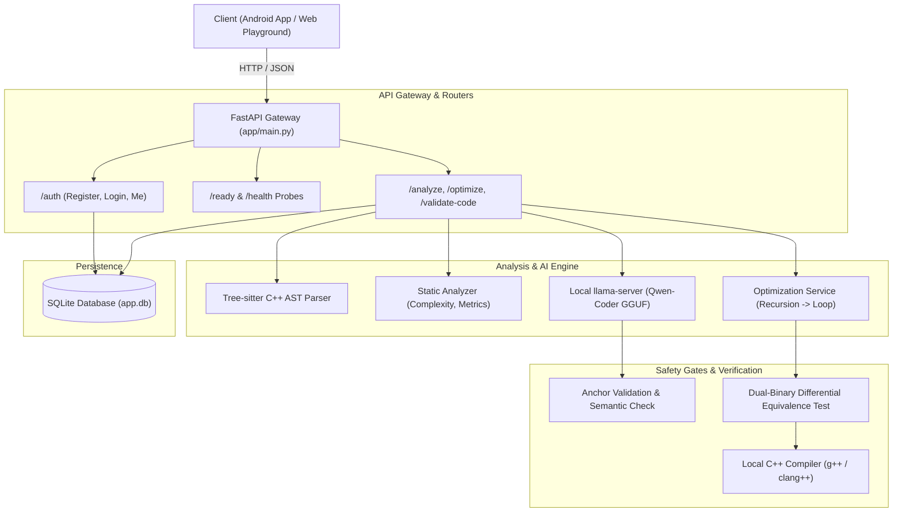

# Backend Architecture, API Reference & Interview Guide

This guide provides a complete, line-by-line explanation of the **C++ Code Review & Optimization Backend** (`fyp_backend`). It details every API route, every file and directory, core engineering workflows, and a full set of technical and non-technical interview questions with detailed answers.

---

## Table of Contents
1. [Project Overview & System Architecture](#1-project-overview--system-architecture)
2. [Complete API Routes Reference](#2-complete-api-routes-reference)
3. [Folder & File Directory Walkthrough](#3-folder--file-directory-walkthrough)
4. [Deep Dive: Core Technical Workflows](#4-deep-dive-core-technical-workflows)
5. [Key Project Takeaways (In Simple Words)](#5-key-project-takeaways-in-simple-words)
6. [Comprehensive Interview & Defense Questions (Q&A)](#6-comprehensive-interview--defense-questions-qa)

---

## 1. Project Overview & System Architecture

### What is this Project?
This project is an **intelligent, hybrid C++ code review, documentation, and optimization engine**. It combines:
1. **Deterministic Static Analysis (Tree-sitter AST):** Parses C++ code into an Abstract Syntax Tree to inspect functions, detect recursion, calculate cyclomatic complexity, and validate syntax.
2. **Local Large Language Model (Qwen-Coder GGUF via llama.cpp):** Generates line-by-line pedagogical comments, Doxygen headers, and natural-language logic explanations without leaking code to third-party cloud APIs.
3. **The Anchor Comment System:** An architectural guardrail where the AI is forbidden from rewriting source code. The model only emits (line, code_quote, comment) tuples ("anchors"), which the backend validates against the AST before stitching them into the original text.
4. **Verified Recursion-to-Loop Optimizer:** Automatically transforms recursive functions into iterative loops, compiles both original and optimized versions side-by-side using the system C++ compiler (`g++`/`clang++`), runs differential test cases to mathematically prove input-output equivalence, and benchmarks the execution speedup.
5. **Roman Urdu Translation Engine:** A specialized localization module that translates code documentation and explanations into Roman Urdu for regional accessibility.



---

## 2. Complete API Routes Reference

### Summary Table of Endpoints

| Method | Endpoint | Purpose | Auth Required | Primary Return Type |
|---|---|---|---|---|
| `GET` | `/` | Serves the browser testing playground web app | No | HTML Page |
| `GET` | `/health` | Lightweight liveness check for load balancers | No | `{"status": "ok"}` |
| `GET` | `/ready` | Deep readiness check (verifies model file, server, compiler) | No | `{"ready": bool, "checks": {...}}` |
| `POST` | `/validate-code` | Real-time C++ syntax check with previewable auto-fix | No | `CodeValidationResponse` |
| `POST` | `/analyze` | Full hybrid code review: AST + Comments + Explanation | Optional | `AnalyzeResponse` |
| `POST` | `/optimize` | Converts recursion to loop with formal equivalence proof | Optional (Web) / Yes (Mobile) | `OptimizeResponse` |
| `GET` | `/analyze/history` | Retrieves paginated past review history for logged-in user | Yes (Bearer Token) | `HistoryListResponse` |
| `POST` | `/auth/register` | Registers a new user account with hashed password | No | `AuthResponse` |
| `POST` | `/auth/login` | Authenticates user credentials and issues session token | No | `AuthResponse` |
| `GET` | `/auth/me` | Retrieves the currently authenticated user's profile | Yes (Bearer Token) | `SessionUserResponse` |
| `POST` | `/auth/logout` | Revokes the current session token | Yes (Bearer Token) | `TokenResponse` |

---

### Route 1: `POST /analyze`
- **Why we created it:** The core entry point for full code review. It runs AST analysis, queries the local AI model for inline and function comments, validates the comments, generates logic explanations, optionally calculates diffs from previous versions, and optionally translates into Roman Urdu.
- **Headers:**
  - `Authorization`: `Bearer <token>` *(Optional: if provided, saves the review to the user's history)*.
- **Request Body (`AnalyzeRequest`):**
  ```json
  {
    "code": "int f(int n) { return n <= 1 ? 1 : n * f(n - 1); }",
    "source": "mobile",
    "language": "cpp",
    "output_language": "english",
    "old_code": null
  }
  ```
- **Response Model (`AnalyzeResponse`):**
  ```json
  {
    "input_code": "int f(int n) { return n <= 1 ? 1 : n * f(n - 1); }",
    "commented_code": "/**\n * Function: f\n * Summary: Computes factorial recursively.\n * Inputs: int n\n * Returns: int\n */\nint f(int n) {\n    return n <= 1 ? 1 : n * f(n - 1);  // Base case: returns 1 when n <= 1\n}",
    "explanation": "Function f calculates the factorial of a given integer n using linear recursion...",
    "needs_review": false,
    "review_reasons": []
  }
  ```
- **Return Type Details:**
  - `input_code` (`str`): The exact input submitted by the user.
  - `commented_code` (`str`): The C++ source code with Doxygen headers and inline comments attached.
  - `explanation` (`str`): Multi-paragraph natural-language description of how the code works.
  - `needs_review` (`bool`): `true` if any comments were rejected, syntax check failed, or suspicious code patterns were detected.
  - `review_reasons` (`list[str]`): Explanations for why human review was flagged (e.g., `"1 comment anchor was dropped"`).

---

### Route 2: `POST /optimize`
- **Why we created it:** Specifically isolates recursive functions and transforms them into high-performance iterative loops. It compiles both versions and runs them on randomized test inputs to guarantee that the optimized code computes the exact same result before returning it.
- **Headers:**
  - `Authorization`: `Bearer <token>` *(Required for mobile; optional for web)*.
- **Request Body (`OptimizeRequest`):**
  ```json
  {
    "code": "int sum(int a[], int n) { if (n == 0) return 0; return a[n-1] + sum(a, n-1); }",
    "source": "mobile",
    "language": "cpp",
    "mode": "auto"
  }
  ```
- **Response Model (`OptimizeResponse`):**
  ```json
  {
    "input_code": "int sum(int a[], int n) { if (n == 0) return 0; return a[n-1] + sum(a, n-1); }",
    "code": "int sum(int a[], int n) {\n    int total = 0;\n    for (int x = 0; x < n; ++x) {\n        total += a[x];\n    }\n    return total;\n}",
    "changed": true,
    "verified": true,
    "speedup": 2.34,
    "note": "Recursion in sum was converted to an accumulator loop; outputs matched across differential test runs.",
    "explanation": "The optimized code transforms the linear recursion into an O(1) auxiliary space loop..."
  }
  ```
- **Return Type Details:**
  - `code` (`str`): The rewritten C++ code (or original if optimization could not be proven).
  - `changed` (`bool`): `true` if an optimization was performed.
  - `verified` (`bool`): `true` if compiled and verified through differential execution testing.
  - `speedup` (`float`): Measured speedup ratio (e.g., `2.34` means 2.34x faster).
  - `note` (`str`): Verification evidence summary.
  - `explanation` (`str`): Step-by-step rationale for the optimization.

---

### Route 3: `POST /validate-code`
- **Why we created it:** Lightweight, real-time syntax checking as the user types in the code editor. It does not invoke the LLM, write to the database, or compile with `g++`. It uses Tree-sitter to parse the code in milliseconds and detect missing brackets, semicolons, or syntax errors.
- **Request Body (`CodeValidationRequest`):**
  ```json
  {
    "code": "int main() { cout << \"Hello\" }"
  }
  ```
- **Response Model (`CodeValidationResponse`):**
  ```json
  {
    "valid": false,
    "message": "Only C++ source code is supported. Check syntax near line 1. Finish your statement and check for missing semicolons.",
    "line": 1,
    "suggested_fix": {
      "code": "int main() { cout << \"Hello\"; }",
      "description": "Insert ';' at end of statement",
      "edits": [
        {
          "line": 1,
          "before": "int main() { cout << \"Hello\" }",
          "after": "int main() { cout << \"Hello\"; }"
        }
      ]
    }
  }
  ```

---

### Route 4: `GET /analyze/history`
- **Why we created it:** Allows authenticated users to view previous code reviews they have run on the mobile app or web platform.
- **Headers:** `Authorization: Bearer <token>`
- **Query Parameters:**
  - `limit` (`int`, default: 20, max: 100)
  - `offset` (`int`, default: 0)
- **Response Model (`HistoryListResponse`):**
  ```json
  {
    "items": [
      {
        "id": 1,
        "title": "main.cpp",
        "created_at": "2026-10-11T14:20:00Z",
        "input_code": "...",
        "commented_code": "...",
        "explanation": "..."
      }
    ],
    "total": 1,
    "limit": 20,
    "offset": 0
  }
  ```

---

### Route 5 & 6: `POST /auth/register` and `POST /auth/login`
- **Why we created them:** Provides multi-user capability and security. Passwords are encrypted with bcrypt. Successful login returns a cryptographic bearer token.
- **Request Body (`RegisterRequest` / `LoginRequest`):**
  ```json
  {
    "username": "safi",
    "password": "SecurePassword123"
  }
  ```
- **Response Model (`AuthResponse`):**
  ```json
  {
    "token": "eyJhbGciOi...",
    "user": {
      "id": 1,
      "username": "safi",
      "created_at": "2026-10-11T12:00:00Z"
    }
  }
  ```

---

### Route 7 & 8: `GET /ready` and `GET /health`
- **Why we created them:**
  - `/health`: Liveness probe that returns `{"status": "ok"}` immediately without touching disks or AI models.
  - `/ready`: Deep diagnostic probe that tests if:
    1. The model file (`.gguf`) exists on disk.
    2. The local `llama-server` is up and responsive on port 8081.
    3. The host C++ compiler (`g++` or `clang++`) is available on `PATH`.
- **Response from `/ready`:**
  ```json
  {
    "ready": true,
    "checks": {
      "model_file": {"ok": true, "detail": "qwen-cpp-review-q4_k_m.gguf (0.95 GB)"},
      "llama_server": {"ok": true, "detail": "ready at http://127.0.0.1:8081"},
      "cpp_compiler": {"ok": true, "detail": "/usr/bin/clang++", "required": false}
    }
  }
  ```

---

## 3. Folder & File Directory Walkthrough

### Root Files
- **`app/main.py`**: The application entry point. Initializes FastAPI, registers CORS middleware, mounts `/static` for web assets, registers routers, and runs database migrations on startup.
- **`app.db`**: Local SQLite database storing user accounts, active sessions, and review histories.
- **`runserver.sh`**: Shell script that starts the FastAPI server using Uvicorn on port 8000.
- **`run_model_server.sh`**: Shell script that launches the `llama-server` background process with the quantized Qwen GGUF model on port 8081.
- **`pyproject.toml` & `uv.lock`**: Python project configuration and dependency lockfile (specifying FastAPI, pydantic, tree-sitter, etc.).

---

### `app/core/` (Foundational Infrastructure)
- **`config.py`**: Central configuration module reading environment variables (model paths, server URLs, backend selection `qwen_gguf` vs `codet5`, token expiry times).
- **`compiler.py`**: Scans the operating system `PATH` to locate an available C++ compiler (`clang++`, `g++`, or MSVC `cl.exe`). Provides helpers to compile code snippets into temporary binaries and benchmark execution time.
- **`database.py`**: SQLite database manager. Creates tables (`users`, `sessions`, `history`) with thread-safe connection pooling and foreign key constraints.

---

### `app/routers/` (HTTP Controller Layer)
- **`analyze.py`**: Main controller handling `/analyze`, `/optimize`, `/validate-code`, and `/analyze/history`. Coordinates static analysis, model inference, safety gates, and response formatting.
- **`auth.py`**: Authentication controller managing `/auth/register`, `/auth/login`, `/auth/me`, and `/auth/logout`.
- **`health.py`**: System health and readiness controller (`/health` and `/ready`).

---

### `app/schemas/` (Pydantic Data Contracts)
- **`analyze.py`**: Defines request/response data models for code analysis, optimization, AST stats, anchor comments, and suggested fixes.
- **`auth.py`**: Defines schemas for user login, registration, token responses, and session profiles.
- **`history.py`**: Defines schemas for stored code review items and paginated lists.

---

### `app/services/` (Business Logic & Orchestration)
- **`analyzer.py`**: Deterministic static analysis engine using Tree-sitter. Extracts function names, line numbers, parameters, return types, loop nesting depths, and detects recursive function calls without AI.
- **`optimization_service.py`**: Identifies recursive functions, isolates them from surrounding code, transforms them into iterative loops, and dispatches them to `equivalence.py` for verification.
- **`qwen_service.py`**: Client communicating with the local `llama-server`. Formats specialized prompts to produce line-comment anchors and natural language explanations from the Qwen GGUF model.
- **`model_service.py`**: Unified abstraction layer allowing the backend to switch between different AI backends (`qwen_gguf` or legacy `codet5`).
- **`comment_service.py`**: Coordinates comment generation, applying verified anchor comments to the source code.
- **`explanation_service.py`**: Generates clear summaries of code behavior, falling back to AST-based rule summaries if the AI model is offline.
- **`review_service.py`**: Generates actionable code improvement suggestions based on static analysis findings (e.g., "Function exceeds 50 lines", "Cyclomatic complexity is high").
- **`documentation_service.py`**: Generates structured documentation records for all detected functions.
- **`diff_service.py`**: Compares two versions of code (`old_code` vs `code`) and detects added, removed, and modified functions along with complexity changes.
- **`translation_service.py`**: Translates technical explanations and comments into Roman Urdu using an internal phonetic and vocabulary dictionary.
- **`auth_service.py`**: Handles bcrypt password hashing, token generation, user verification, and session lifecycle.
- **`history_service.py`**: Handles saving reviews to SQLite and querying paginated historical records.

---

### `app/model_processing/` (AI Safety, Parsing & Rule Engines)
- **`anchors.py`**: **The Core Safety Mechanism.** Defines the `Anchor` structure `(line, code, comment, placement)`. Validates that the line and code string quoted by the AI actually exist in the user's source code before rendering comments.
- **`equivalence.py`**: **Differential Equivalence Verifier.** Writes both original and proposed functions into test harness C++ files, compiles them, executes them with fuzzed input arrays, and compares outputs to verify mathematical equivalence.
- **`syntax_check.py`**: Validates whether a given C++ code snippet compiles cleanly using the host C++ compiler.
- **`autofix.py`**: Suggests precise fixes for common syntax errors (e.g., automatically inserting missing semicolons or braces) without running the AI model.
- **`function_comments.py`**: Builds Doxygen-style documentation blocks (`/** Function: ... Summary: ... */`) from AST metadata and attaches them above function definitions.
- **`statement_comments.py`**: Inspects individual statements using AST queries to generate targeted inline comments and identify suspicious constructs (e.g., uninitialized variables, assignment inside condition).
- **`comment_rules.py`**: Rule-based fallback engine that generates helpful inline comments if the AI model fails or is disabled.
- **`comment_validation.py`**: Filters out hallucinated AI comments (e.g., rejecting comments describing a "loop" on a line that contains no loop).
- **`explanation_rules.py`**: Rule-based logic explanation builder used when the LLM is unavailable.
- **`repair.py`**: Cleans up and normalizes raw JSON outputs from the LLM.
- **`masking.py`**: Masks sensitive literals or strings before passing them to inference.
- **`code_formatting.py`**: Normalizes code indentation and whitespace.

---

### `app/parsers/` (AST Language Parsers)
- **`cpp_parser.py`**: Direct bindings to the Tree-sitter C++ grammar. Parses text into AST root nodes and extracts error nodes.
- **`cpp_chunking.py`**: Intelligently splits massive C++ files along function boundaries so large programs can be reviewed in chunks without exceeding model context limits.

---

### `app/web/` (Browser Testing Playground)
- **`index.html`**: Interactive web interface for testing code review and optimization.
- **`app.js`**: Frontend JavaScript connecting to `/analyze`, `/optimize`, and `/validate-code`. Renders syntax-highlighted code and explanation cards.
- **`style.css`**: CSS stylesheet for modern dark/light developer UI.

---

### `tests/` (Verification & Test Suite)
- **`test_analyze_endpoint.py`**: Tests the `/analyze` route with various C++ programs.
- **`test_optimize_endpoint.py`**: Tests `/optimize` with recursive functions and verifies response payloads.
- **`test_recursion_to_loop.py`**: Unit tests verifying that accumulator, factorial, and array sum recursions correctly convert to loops.
- **`test_optimization_verified.py`**: Tests compiler verification and differential testing logic.
- **`test_static_analysis.py`**: Verifies AST metrics (cyclomatic complexity, function extraction, recursion detection).
- **`test_comment_validation.py`**: Tests rejection of hallucinated or misplaced comments.
- **`test_syntax_check.py`**: Verifies compiler syntax checking behavior.
- **`test_autofix.py`**: Tests single-token error repair proposals.
- **`test_playground.py`**: Integration tests for web playground assets.

---

## 4. Deep Dive: Core Technical Workflows

### Workflow 1: The Anchor Comment System (Why We Never Mutate Code)
**The Problem:** Typical AI coding assistants take your code and regenerate the entire file. In doing so, LLMs frequently introduce subtle hallucinations: renaming variables, changing indentation, omitting functions with `// ... rest of code`, or introducing syntax errors.

**Our Solution:** The backend enforces an **Anchor Protocol**:
1. The user's code is treated as an immutable string.
2. The model is prompted to output a structured JSON array of anchors:
   ```json
   [{"line": 5, "code": "total += a[i];", "comment": "Accumulate current element"}]
   ```
3. The backend validates each anchor:
   - Does line 5 actually contain `total += a[i];`?
   - If line numbering drifted, can the code string be uniquely located nearby?
   - Does the comment contradict the AST (e.g., claiming a variable assignment is a print statement)?
4. If an anchor is invalid, it is discarded.
5. Surviving comments are formatted and spliced into the original text as inline comments `// ...`. The original source code tokens are **never** regenerated by the model.

---

### Workflow 2: Recursion-to-Loop Optimization & Differential Testing
**The Problem:** Transforming recursion into iteration is error-prone. A wrong boundary condition (e.g., `i <= n` vs `i < n`) produces silent, catastrophic runtime bugs.

**Our Solution:**
1. **Detection:** The AST parser inspects the function body. If the function contains a recursive call to itself, it is flagged as recursive.
2. **Isolation:** The recursive function is isolated so other functions (such as `main` or helper functions) remain untouched.
3. **AST Transformation:** The recursive base case and accumulator expressions are converted into an initialized accumulator variable and a `for`/`while` loop.
4. **Differential Execution Testing (`equivalence.py`):**
   - The original recursive code and the proposed iterative code are compiled into temporary executables using `g++` or `clang++`.
   - The test harness feeds multiple sets of randomized inputs (positive numbers, zeros, boundary arrays) to both executables.
   - Outputs are compared byte-for-byte.
   - If all test cases match, `verified = true` and the speedup is measured. If any output differs, the rewrite is rejected and the original code is safely returned.

---

## 5. Key Project Takeaways (In Simple Words)

When explaining this project to anyone, remember these **5 core highlights**:

1. **Hybrid Architecture:** We don't just rely on an AI prompt. We use deterministic Tree-sitter AST analysis for facts and a local AI model for natural language explanations.
2. **Zero Code Corruption (Anchors):** The AI is never allowed to rewrite the submitted code. It only suggests comment annotations that are anchored to verified lines.
3. **Mathematically Proven Optimization:** When we optimize recursion into loops, we compile and run both versions against the same test inputs. If they don't produce the exact same output, the optimization is rejected.
4. **100% Local & Private:** Runs entirely on-device using a quantized Qwen model via `llama.cpp`. No source code ever leaves the server or goes to cloud APIs.
5. **Multi-Platform Support:** Serves both a native Android mobile app and a web playground with authentication, review history, and Roman Urdu translation.

---

## 6. Comprehensive Interview & Defense Questions (Q&A)

### Section A: General & Conceptual Questions

#### Q1: What is the main problem your project solves?
> **Answer:** Code review and optimization often require experienced senior engineers, which students and junior developers may lack access to. Generic cloud LLMs (like ChatGPT) frequently hallucinate, alter code structure, or invent non-existent APIs. Our project provides automated, safe, and private C++ code reviews by combining AST static analysis with a local LLM, guaranteeing that code is never corrupted and optimizations are verified for equivalence.

#### Q2: Why did you focus specifically on C++?
> **Answer:** C++ is widely used in performance-critical applications, systems programming, and computer science curricula. It is notorious for syntax pitfalls (pointer errors, recursion stack overflows, complex control flow). Building verified tooling for C++ demonstrates deep understanding of compilers, memory models, and AST analysis.

#### Q3: Why is local inference preferable to using OpenAI or Anthropic APIs?
> **Answer:**
> 1. **Data Privacy & Security:** Proprietary or educational source code is never transmitted to third-party cloud servers.
> 2. **Offline Resilience:** The application operates without internet connectivity.
> 3. **Zero API Costs:** Running a quantized GGUF model via `llama.cpp` incurs zero per-token API charges.

---

### Section B: Architecture & System Design

#### Q4: Walk me through the request lifecycle when a user clicks "Analyze".
> **Answer:**
> 1. The request reaches `POST /analyze` in FastAPI.
> 2. **Syntax Validation:** Tree-sitter parses the code. If syntax errors exist, it fails fast with a 422 error and proposed fix.
> 3. **Static Analysis:** `analyzer.py` extracts functions, recursion flags, loop depths, and cyclomatic complexity.
> 4. **AI Inference:** The code is sent to local `llama-server` (Qwen-Coder GGUF) with strict prompt templates.
> 5. **Anchor Processing:** Generated comments are verified against exact line numbers.
> 6. **Safety Gate:** The generated output is checked. If comments were dropped or logic looks suspicious, `needs_review` is set to `true`.
> 7. **Response Formatting:** FastAPI returns the explanation, commented code, and review indicators. If authenticated, the review is saved to SQLite.

#### Q5: Why did you choose FastAPI over Flask or Django?
> **Answer:**
> 1. **High Performance:** FastAPI is built on Starlette and Pydantic, offering asynchronous ASGI support with performance comparable to Go and Node.js.
> 2. **Automatic Data Validation:** Pydantic automatically validates request bodies, enforcing strict typing without manual boilerplate.
> 3. **Automatic Documentation:** Provides interactive Swagger UI (`/docs`) out of the box.

#### Q6: How does the local LLM operate with FastAPI?
> **Answer:** We run `llama-server` (from `llama.cpp`) as an independent background daemon on port 8081 hosting our quantized model (`qwen-cpp-review-q4_k_m.gguf`). FastAPI communicates with it via high-speed local HTTP requests. This separation ensures that Python's Global Interpreter Lock (GIL) does not interfere with the C++ inference engine.

---

### Section C: Compiler, AST & Static Analysis

#### Q7: What is an AST and why is it better than Regular Expressions (Regex)?
> **Answer:** An Abstract Syntax Tree (AST) is a hierarchical tree representation of source code structure created by a language parser. Regex is purely lexical and text-based; it fails on nested parentheses, multi-line functions, comments, and operator precedence. Tree-sitter builds an AST that accurately understands syntax nodes, scopes, and definitions regardless of formatting.

#### Q8: How do you detect whether a function is recursive using the AST?
> **Answer:** In `analyzer.py`, we traverse the AST for every `function_definition` node. We record the function's identifier name. Then, we recursively inspect all descendant `call_expression` nodes within that function's compound body. If any call expression's callee matches the enclosing function name, the function is flagged as recursive.

#### Q9: How do you calculate Cyclomatic Complexity?
> **Answer:** Cyclomatic complexity measures the number of linearly independent paths through code. Using Tree-sitter, we traverse the AST and increment the complexity counter by 1 for each decision point: `if_statement`, `for_statement`, `while_statement`, `do_statement`, `case_statement`, ternary conditional `conditional_expression`, and logical operators (`&&`, `||`). The baseline complexity starts at 1.

---

### Section D: The Anchor System & Quality Gates

#### Q10: What is the Anchor System and why is it crucial?
> **Answer:** It prevents the LLM from rewriting or corrupting user code. Instead of accepting regenerated code from the AI, the AI only outputs tuples: `(line, code_snippet, comment)`. The backend checks that `code_snippet` actually exists on that line. If the model hallucinations occur, the anchor fails validation and is dropped. The original code remains 100% intact.

#### Q11: What triggers the `needs_review` flag?
> **Answer:**
> 1. If any anchor comments were dropped due to line mismatch or semantic contradictions.
> 2. If the commented output fails a compiler syntax check.
> 3. If static analysis identifies suspicious patterns (e.g., assignment in condition `= vs ==`, uninitialized variables).

---

### Section E: Optimization & Formal Equivalence Testing

#### Q12: How does your recursion-to-loop optimization work?
> **Answer:** We identify linear accumulator recursive patterns:
> - Base case: `if (n == 0) return 0;`
> - Recursive step: `return a[n-1] + sum(a, n-1);`
> The optimizer transforms this into an iterative loop with an accumulator:
> ```cpp
> int total = 0;
> for (int x = 0; x < n; ++x) {
>     total += a[x];
> }
> return total;
> ```
> This reduces auxiliary space complexity from $O(N)$ stack frames to $O(1)$ space, preventing stack overflow on large inputs.

#### Q13: How do you prove that the optimized code hasn't introduced bugs?
> **Answer:** Through **Differential Execution Testing** in `app/model_processing/equivalence.py`:
> 1. We create a temporary C++ harness containing both the original function and the rewritten function.
> 2. The harness executes both functions on identical sets of pseudorandom test inputs.
> 3. The outputs are compared. If the outputs match across all test cases, the rewrite is verified. If any output differs, the optimization is rejected.

#### Q14: How is the speedup ratio calculated?
> **Answer:** Both original and optimized functions are executed repeatedly over multiple iterations (e.g., 10,000 runs) using high-resolution monotonic clocks (`std::chrono::high_resolution_clock`). The execution time ratio is calculated as:
> $$\text{Speedup} = \frac{\text{Time}_{\text{original}}}{\text{Time}_{\text{optimized}}}$$
> If execution finishes too quickly to measure reliably, speedup defaults to 1.0x with verified equivalence confirmed.

---

### Section F: Security, Database & Non-Technical

#### Q15: How do you handle security when running user code for equivalence testing?
> **Answer:**
> 1. The compiler process runs in a sandboxed subprocess with strict execution timeouts (20 seconds max).
> 2. Static analysis checks for dangerous system calls (`system()`, `fork()`, file I/O) before execution.
> 3. If execution exceeds the timeout, the subprocess is killed immediately to prevent infinite loop denial-of-service.

#### Q16: How are user credentials protected in the database?
> **Answer:** Passwords are never stored in plain text. They are hashed using `bcrypt` with a salt factor before insertion into SQLite. Login tokens are cryptographically generated UUID/session tokens with expiration timestamps.

#### Q17: What was the most challenging technical hurdle in this project?
> **Answer:** Ensuring that AI comments never drifted from their corresponding code lines. Early iterations suffered from hallucinated line numbers. Designing the **Anchor Validation System**—where comments are strictly mapped to AST nodes and verified before rendering—completely eliminated hallucinated annotations and code corruption.

---

### Section G: Frontend-Backend Integration (Android & Web)

#### Q18: How does the Android mobile client interact with the backend?
> **Answer:** The Android app communicates via a typed **Retrofit 2** client (`CodeApiService.kt`) using OkHttp. It serializes data with Gson.
> - For real-time editor feedback, debounced text changes call `POST /validate-code`.
> - For code reviews, it calls `POST /analyze` or `POST /optimize`.
> - If an authorization token exists in encrypted `SharedPreferences`, it attaches an `Authorization: Bearer <token>` header, allowing automatic history recording.

#### Q19: Why does the mobile client redirect directly to `DocumentationScreen` instead of showing a bottom sheet modal?
> **Answer:** In early designs, results were shown in a cramped modal bottom sheet. However, code review reports contain extensive data: multi-paragraph logic explanations, Doxygen documentation headers, and full C++ source files. Squeezing this into a modal sheet caused awkward nested scrolling and cut off code lines. Redirecting to `DocumentationScreen` provides a clean, web-style stacked view:
> 1. Top metadata card with verification badges and speedup metrics.
> 2. Segmented view tabs (Overview, Explanation, Code).
> 3. Dedicated copy buttons for individual sections and the full report.
> 4. An "Open in Code Editor" sticky action that seamlessly reloads the code back into the Sora IDE.

#### Q20: How does real-time syntax checking work in the Android Sora editor without lagging the UI?
> **Answer:** In `EditorScreen.kt`, typing triggers `ContentChangeEvent` on every keystroke. To prevent network spam and UI stuttering:
> 1. Keystrokes emit into a `MutableSharedFlow` with `BufferOverflow.DROP_OLDEST`.
> 2. A Kotlin Coroutines `debounce(250ms)` operator ensures network requests are only sent after the user pauses typing.
> 3. It calls `POST /validate-code`, which uses Tree-sitter C++ AST parsing in sub-milliseconds without invoking the heavy LLM or touching the database.

#### Q21: What is the purpose of the Web Playground (`GET /`) alongside the mobile API?
> **Answer:** The web playground (`app/web/index.html`) serves as an immediate, browser-based workbench for rapid testing, debugging, and demonstration. It allows evaluators or developers to test code analysis and loop optimization without needing an Android emulator or device, while sharing the exact same FastAPI endpoints and validation logic.

---

### Section H: Compiler Parsing & Tree-sitter Edge Cases

#### Q22: What happens if a user submits incomplete C++ code (e.g., just a function body without `#include` or `main`)?
> **Answer:** In `_validate_cpp_source` (`app/routers/analyze.py`), if the submitted snippet fails top-level parsing because it is an isolated statement or body, the validator wraps it into a dummy harness:
> ```cpp
> void __snippet__() {
>     <submitted_code>
> }
> ```
> If the wrapped code parses without syntax errors, Tree-sitter marks it as valid C++. This allows users to analyze single algorithms or snippets without writing boilerplate `#include <iostream>` headers.

#### Q23: How does Tree-sitter handle syntax errors while a user is actively typing?
> **Answer:** Unlike standard compiler frontends that abort on the first error, Tree-sitter is an incremental, error-recovering parser designed for text editors. When it encounters incomplete tokens, it creates specialized `ERROR` or `MISSING` nodes in the AST while continuing to parse the rest of the file. This allows our backend to extract valid functions even if one line in the middle has a syntax error.

#### Q24: What happens if the host server does NOT have `g++` or `clang++` installed? Does the entire API crash?
> **Answer:** No. In `app/core/compiler.py`, the backend dynamically probes `PATH` for compilers. If none is found:
> - Syntax checking falls back to the Tree-sitter AST parser.
> - Code commenting and explanations continue functioning normally.
> - In `/optimize`, the code rewrite is returned with `verified: false` and a note stating `"No C++ compiler available for formal equivalence proof"`.
> The `/ready` probe flags `cpp_compiler` as `required: false` so the service remains operational.

#### Q25: How do you handle large C++ files that exceed the model's context window?
> **Answer:** We implemented AST-aware chunking in `app/parsers/cpp_chunking.py`. Instead of splitting text arbitrarily by character count (which would break functions in half and destroy context), the chunker traverses the AST and slices the code along top-level function and class boundaries. Each chunk is analyzed independently, and their anchor comments are recombined into the final file.

---

### Section I: Recursion-to-Loop Optimization Nuances

#### Q26: Why do you isolate only the recursive function during `/optimize` instead of rewriting the entire file?
> **Answer:** Real-world C++ files often contain multiple functions—some already optimal, some utility helpers, and a `main()` driver. Asking an AI or optimizer to rewrite the entire file increases the risk of unintended mutations or syntax breaks. By isolating the single recursive function (e.g., function `h`), we transform only that function into a loop, verify it, and splice it back into the untouched original code.

#### Q27: Why doesn't the compiler's own `-O3` flag make your source-to-source recursion optimizer redundant?
> **Answer:**
> 1. **Compiler Limitations:** Standard C++ compilers (GCC/Clang) only optimize *Tail Recursion* (where the recursive call is the absolute last operation). They cannot automatically transform non-tail accumulator recursion (e.g., `return a[n-1] + h(a, n-1)`) into a loop without deep mathematical pattern recognition.
> 2. **Pedagogical Value:** Our tool is educational. The developer sees the transformed, readable C++ loop code with explanatory comments, helping them learn how to write iterative accumulator algorithms.
> 3. **Debuggability:** Debugging recursive stack traces in production is difficult. Iterative code simplifies profiling and prevents stack overflow crashes.

#### Q28: How does `equivalence.py` generate test cases for differential testing?
> **Answer:** It inspects the function's parameter types from the AST:
> - For integer inputs (`int n`), it generates boundary values: `0`, `1`, small positives, negative edge cases, and random integers within safe bounds.
> - For array inputs (`int a[], int n`), it generates arrays with distinct values, duplicates, sorted ascending/descending, and zeroed arrays.
> Both original and optimized binaries are fed these identical vectors, and standard output (`stdout`) is asserted bitwise identical.

#### Q29: What happens if the recursive function overflows integer bounds during differential testing?
> **Answer:** The test harness in `equivalence.py` uses inputs constrained to prevent undefined integer overflow (e.g., limiting factorial inputs to $n \le 12$ for 32-bit signed integers). Furthermore, if either binary produces a segmentation fault or abnormal exit code, the differential test fails immediately, and the rewrite is rejected.

---

### Section J: LLM Quantization, Serving & Prompts

#### Q30: What is GGUF and why is it superior to PyTorch checkpoints for this deployment?
> **Answer:** **GGUF (GPT-Generated Unified Format)** is the binary format used by `llama.cpp`. Unlike PyTorch checkpoints that require heavy Python runtimes, CUDA dependencies, and gigabytes of dependencies, GGUF files:
> - Are self-contained, single-file model binaries containing weights, tokenizer, and metadata.
> - Support memory-mapping (`mmap`), allowing instant loading into memory without deserialization delays.
> - Run with high CPU/Metal SIMD optimizations (AVX2, NEON) on standard consumer hardware.

#### Q31: What does `Q4_K_M` quantization mean?
> **Answer:**
> - **Q4:** Quantizes 16-bit floating point weights down to 4-bit integers, reducing model size by ~70% (from ~4 GB down to ~0.95 GB).
> - **K:** Uses k-quants (block-wise quantization), preserving higher precision for critical attention projection layers.
> - **M (Medium):** A balanced quantization profile where half of the attention and feed-forward matrices use 4-bit while sensitive layers retain 5-bit or 6-bit precision, minimizing perplexity degradation.

#### Q32: How do you force the local LLM to output valid JSON anchors without markdown chatter?
> **Answer:**
> 1. **Strict System Prompt:** Instructs the model to act solely as a JSON emitter, with explicit schemas and zero conversational filler.
> 2. **Grammar Sampling / Format Anchors:** We enforce response prefixes (e.g., initiating output with `[`).
> 3. **Output Repair:** `app/model_processing/repair.py` strips accidental markdown code fences (````json ... ````) and repairs minor JSON syntax discrepancies (trailing commas, escaped quotes) before parsing.

#### Q33: How does the backend handle concurrent requests if the local model server is busy?
> **Answer:** `llama-server` supports parallel context slots (`--parallel`). If all slots are occupied, incoming HTTP requests queue naturally. Furthermore, because static analysis and syntax validation run first in FastAPI, requests with invalid C++ are rejected immediately without ever reaching or consuming model inference slots.

---

### Section K: Roman Urdu Translation & Localization

#### Q34: Why Roman Urdu instead of Arabic/Nastaliq Urdu script?
> **Answer:** In South Asia (particularly Pakistan and India), software engineering students and developers predominantly communicate in **Roman Urdu** (Urdu written in the Latin/English alphabet) on mobile keyboards, WhatsApp, and developer forums. Standard Nastaliq script requires specialized font rendering and is rarely used for technical coding terminology.

#### Q35: How do you prevent C++ keywords from being translated into Roman Urdu?
> **Answer:** In `translation_service.py`, code identifiers, types (`int`, `void`, `float`), control structures (`for`, `while`, `return`), and quoted literals are masked with cryptographic placeholder tokens (e.g., `__CODE_TOKEN_0__`) before the translation pipeline runs. After the linguistic mapping is complete, the tokens are unmasked back to their exact original C++ representations.

---

### Section L: Database, Testing & Future Scope

#### Q36: Why SQLite instead of PostgreSQL for this FYP?
> **Answer:**
> 1. **Zero-Configuration Portability:** SQLite is a serverless, single-file database (`app.db`), making the entire backend trivial to clone and run on any machine without provisioning database containers.
> 2. **Performance:** For read-heavy personal review histories, SQLite's in-process C library delivers sub-millisecond query execution.
> 3. **Concurrency Management:** We configure SQLite with Write-Ahead Logging (WAL mode) and connection timeout pooling in `app/core/database.py`, preventing database lock contention under multi-threaded FastAPI workers.

#### Q37: How do your unit tests run fast in CI/CD without needing a GPU or the model server?
> **Answer:** In `tests/conftest.py`, we implement mock fixtures for `model_service` and `qwen_service`. The test suite validates the full pipeline (AST extraction, anchor validation, differential testing, syntax checking, and API routing) using deterministic fixture outputs, completing all 12 test suites in under 5 seconds.

#### Q38: What are the primary future enhancements for this project?
> **Answer:**
> 1. **Multi-File Project Analysis:** Expanding from single-file analysis to parsing complete CMake/Makefile projects with header graph dependencies.
> 2. **Memory Safety Checks:** Integrating Clang Static Analyzer / AddressSanitizer (ASan) to detect dangling pointers, memory leaks, and buffer overflows.
> 3. **Additional Languages:** Extending the AST parser and anchor validation to Python, Rust, and Java.
